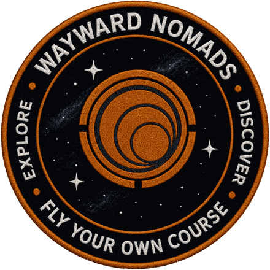

  

# Wayward Nomads Toolbox (WNTB)

A free add-on for **Elite Dangerous** that puts a set of handy tools in one panel: Powerplay tracking,
exploration helpers, mining, trading (profit tracking, routes, prices and fleet carrier cargo), missions, on-foot and
cargo tracking, and more. It was built for the
**Wayward Nomads** exploration squadron (WWNS) and is open to anyone who wants it.

It runs inside [EDMC](https://github.com/EDCD/EDMarketConnector) (Elite Dangerous Market Connector), a
free companion program many commanders already use. You don't need to know any programming to use WNTB.

> **Download the latest release, not the repository.** See [Quick start](#quick-start). If you hit a
> problem, see [Getting help](#getting-help).

Built and maintained by R.W. Harper: CMDR Bocheaux (Wayward Nomads, WWNS) and CMDR Mactavious (Easy Day, EZPZ).

---

## Contents

- [What's in the toolbox](#whats-in-the-toolbox)
- [Planned and being researched](#planned-and-being-researched)
- [Quick start](#quick-start)
- [Tips, quirks and workarounds](#tips-quirks-and-workarounds)
- [Guides](#guides)
- [Getting help](#getting-help)
- [For developers, credits and licence](#for-developers-credits-and-licence)

---

## What's in the toolbox

WNTB has one panel with eight **modes**. You click a button to switch between them.

| Mode | What it's for | Guide |
|---|---|---|
| **Powerplay** | Tracks the merits and Control Points you earn for your Power, and finds rare goods. | [Powerplay](docs/guide/powerplay.md) |
| **Exploration** | Auto-honk, "first discovery" and notable-body alerts, a boxel survey tool, scan values and how far through a system you are, what your data sales actually paid, exobiology help, and a lifetime tally of everything you've scanned. | [Exploration](docs/guide/exploration.md) |
| **Mining** | Tracks space mining and surface (SRV) mining, and keeps your own catalogue of mining hotspots. | [Mining](docs/guide/mining.md) |
| **Trade** | Your trading profit after fuel and repairs, what fills your ship hold (cargo, mission, stolen, limpets), your fleet carrier's cargo space, tritium, location and orders, saved sessions in a Trade History window, and Spansh lookups for the best trade routes and the best place to buy or sell. | [Trade](docs/guide/trade.md) |
| **Missions** | One view of every mission you have, with kill-progress bars for massacre missions and collect / delivery progress for cargo missions. | [Missions](docs/guide/missions.md) |
| **Field Ops** | Screenshots, your backpack/locker/cargo and saved ship builds. | [Field Ops](docs/guide/field-ops.md) |
| **Colonization** | The project you are building now, your colonization history, and a window with every site's shopping list and where to buy. | [Colonization](docs/guide/colonization.md) |
| **BGS** | Tracks the Background Simulation: faction states, and what your own activity does to them. | [BGS](docs/guide/bgs.md) |

Two more tools are always on and don't belong to a mode: **Landing Assist** and **Interdiction Warning**
([guide](docs/guide/always-on.md)).

Most individual features have their own on/off switch in Settings, and the alerts and overlays are off until you turn
them on. The eight mode buttons themselves can't be hidden, and a few sections (for example Boxel Survey and the GEC
and Canonn POI finders) can only be folded away, not switched off.

**Each commander's data is separate.** Hotspots, surveys, sessions, Codex tallies and everything else WNTB saves belong
to the commander you are playing; nothing is shared between commanders.

**Playing with EDMC closed is fine.** When EDMC starts, WNTB reads the recent journal files and catches up on what it
missed (trades, missions, colonisation deliveries, Codex finds, merits and more), counting nothing twice. Getting
started has a table of what each feature catches up on and how far back.

**Full disclosure.** WNTB can only show what the game writes to its journal files and what services such as Spansh
and EDSM publish. Some things the game never records, or records late or in part (for example, a fleet carrier's
cargo is only exact after you open Carrier Management). Each mode guide ends with a section, "What the game does and
doesn't tell us, and how to work around it", listing every gap we know of and what to do about it. Estimates are
marked as estimates on screen.

> **Colonization is a work in progress.** The COL page, the Colonization Sites window and the overlay shopping list work
> today, but more is planned: **co-op building** (several commanders working on one project) and **colony tracking**, which
> will come through a separate app that is in development. WNTB will connect to it when it is ready. Until then everything
> on the COL page is about **you**: your deliveries, your ship and your carrier. Expect rough edges and changes.

> **Linux is lightly tested for this release.** The newest parts (Colonization, and the Overlays tab with Placement and
> Appearance) have had a first pass on Linux and look fine, but a few small fixes for Linux are expected in a later
> update. If something looks off there, please [report it](#getting-help).

## Planned and being researched

Things I would like to add or am still looking into, by feature. This is a wish list, not a promise: there are no dates, the order
can change, and some of it may turn out not to be possible. If one of these matters to you, tell me (see [Getting help](#getting-help)).

**Colonization**
- **Raven Colonial** is used as a read-only reference (the Planned Builds window reads a system's plan). Sending your own deliveries
  there is not planned for now; if it ever happens it would be strictly **opt-in and off by default**, and the internet page would
  list exactly what is sent and when before it exists.
- **Where to buy, improved on WNTB's own terms:** searching for the whole list with fewer requests, from the sources WNTB already uses.
- **Team projects:** several commanders on one project, with a "what the team still needs" line. Everything today is per commander and
  would stay that way until you choose to share.
- **Co-op building and colony tracking** through a separate app that is in development; WNTB is to connect to it when it is ready.
- *Being researched, may not happen:* tonnes per hour and credits earned per delivery. The journal does not say how long you spent
  hauling, and I have not been able to confirm that the credits a depot lists are what is actually paid.

**Landing Assist**
- **My own pad layouts,** with fore and aft cues and diagrams for facilities that have none today, settlements first. I need to
  confirm the pad numbering of settlements in the game before drawing any, so nothing misleading ships.

**Trade**
- **Round trip:** a Powerplay bonus filter (that depends on what the price service can tell me).

**Overlays**
- **Tidier default spots,** where a few displays overlap on some screen shapes (for example Colonization, Landing and the Mining
  waypoint on the left of a 16:9 screen). They rarely show together, so this is low priority.

**Everywhere**
- **More checking in the game on both Windows and Linux.** Several newer parts have had a first pass only, and each guide ends with
  a list of what the game does not tell us.

## Quick start

**You need:** [EDMC](https://github.com/EDCD/EDMarketConnector) on Windows or Linux. For on-screen alerts you also
need an overlay ([EDMCModernOverlay](https://github.com/SweetJonnySauce/EDMCModernOverlay) is recommended), but
everything else works without one.

1. Download **`WNTB.zip`** from the [latest release](https://github.com/rwharpernc/wayward-nomads-toolbox/releases/latest)
   (under **Assets**). Don't use the green **Code → Download ZIP** button.
2. In EDMC open **File → Settings → Plugins → Open** (the plugins folder) and extract the ZIP there, so you end up
   with `plugins/WNTB/load.py`.
3. Restart EDMC. The **Wayward Nomads Toolbox (WNTB)** panel appears.
4. Click the mode buttons under the WNTB title to switch modes. Hover over any button to see its full name. Settings
   are under **File → Settings → WNTB**.

On **Linux**, one more step is needed so WNTB can read your game's journals. See [WNTB on Linux](docs/guide/linux.md).

To update, extract the new ZIP over the old `WNTB` folder (don't delete it first: your saved data lives there).

## Tips, quirks and workarounds

Things that surprise people, and what to do about them. Every mode guide has a longer list at its end.

**Installing and updating**
- **Restart EDMC** after installing or updating. The WNTB panel only appears after a restart.
- Extract the ZIP **over** the old `WNTB` folder, don't delete it first: your saved data lives there.
- Use the ZIP from the **Releases** page (Assets), not the green **Code → Download ZIP** button.
- The WNTB panel is a little wider since 1.6.0 (there are eight mode buttons). EDMC sizes its window to the widest
  plugin, so you may see the main window grow slightly.

**EDMC, the journal and catching up**
- **Run EDMC** while you play. If you forget, WNTB catches up from your recent journals when EDMC starts (up to about 14 to 30
  days for most features), counting nothing twice. It cannot catch up on things the game never writes down.
- WNTB only knows what the game writes to its journal. Where it can't be sure, it says so. Each guide lists these gaps and
  the workaround in "What the game does and doesn't tell us".
- Everything is kept **per commander**. Switching commanders in EDMC switches the data.
- **Linux:** EDMC's **Journal directory** must point at Elite's journal folder inside the Proton/Wine folder, or most
  features will find nothing. Auto-Honk and the screenshot timer also need `xdotool`, and a Flatpak EDMC needs permissions
  granted. See [WNTB on Linux](docs/guide/linux.md).

**On-screen overlays**
- Overlays need an overlay program running ([EDMCModernOverlay](https://github.com/SweetJonnySauce/EDMCModernOverlay) is
  recommended). Press a **Test** button to check. Everything is **off until you turn it on**.
- All overlay settings are in one place: **Settings → WNTB → Overlays** (Connection, Placement, Appearance, and a tab per feature).
- **Placement** puts each display at one of nine spots plus pixel offsets, read from your real screen. If it looks wrong,
  press **Show placement preview**, then **Detect screen again**, or **Reset all to defaults**. The overlay can't draw
  flush against the right edge by itself; WNTB works around that with an offset (a switch on the Placement tab turns it off).
- **Appearance** sets the text size, padding, line spacing and color scheme for every overlay. Larger text makes bigger
  cards. The Interdiction warning always stays red.
- Run Elite in borderless or windowed mode; some overlays can't draw over exclusive fullscreen (see the [overlay setup](docs/OVERLAY_SETUP.md)).

**Colonization (work in progress)**
- Dock at a construction depot (or open its market) **once** to register a site. Nothing is typed in.
- The COL page and window show **your** deliveries and cargo. The depot's totals include everyone's deliveries.
- Your **history is rebuilt once from all your journal files** and counts from the first delivery in them (the page says the date). Deleted journals can't be counted.
- **Fleet carrier cargo:** the journal only records cargo you *transfer* to the carrier. For the real hold, sign EDMC in to
  Frontier and open **Carrier Management** once; WNTB then reads the carrier's actual cargo. It can lag behind the game.
- Commanders **without** a carrier see simpler wording and one Trips column; the carrier lines appear only if you have one.
- **Where to buy** needs the internet (Spansh) and caches a search for two minutes.
- Shopping-list overlay: it appears when you are at a market, in Carrier Management or at a construction site. The
  **OVERLAY** button forces it on.

**Windows**
- If screenshots don't save, Windows **Controlled Folder Access** or your antivirus may be blocking EDMC. Allow it, or choose
  another folder.

## Guides

**Set up and learn the basics**

- [Getting started](docs/guide/getting-started.md): installing, updating, finding your way around, every pop-out
  window, every button name.
- [Setting up the on-screen overlay](docs/OVERLAY_SETUP.md)
- [Windows and Linux](docs/guide/platforms.md): what works where.
- [WNTB on Linux](docs/guide/linux.md): step-by-step, including Flatpak EDMC.
- [What goes on the internet](docs/guide/internet-and-privacy.md): every feature that contacts an outside site.

**Use the modes**: see the table above, or the [full guide index](docs/guide/README.md).

**When something's wrong**: [Troubleshooting](docs/guide/troubleshooting.md).

## Getting help

Found a bug, or have an idea? Please open an issue on the project's
[Issues page](https://github.com/rwharpernc/wayward-nomads-toolbox/issues), or find me in the Wayward Nomads
squadron. Say what you were doing, what you expected, and what happened. Including EDMC's log (EDMC's Help menu can
open its log folder) helps a lot. The squadron website is [waywardnomads.org](https://waywardnomads.org/).

## For developers, credits and licence

- **[docs/DEVELOPMENT.md](docs/DEVELOPMENT.md)**: setting up to build, test and change WNTB.
- **[docs/TECHNICAL.md](docs/TECHNICAL.md)**: how WNTB works and why it's built that way.
- **[docs/MODULES.md](docs/MODULES.md)**: every module in `plugin/`, by feature, in one line each.
- **Feature specifications**, each covering what a feature reads, its rules and its limits:
  [Missions](docs/MISSIONS_TECH_SPEC.md), [Mining](docs/MINING_TECH_SPEC.md),
  [Trade](docs/TRADE_TECH_SPEC.md), [Boxel Survey](docs/BOXEL_SURVEY_TECH_SPEC.md), [BGS](docs/BGS_TECH_SPEC.md),
  [Organic Scanning](docs/ORGANIC_SCANNING_TECH_SPEC.md), [Powerplay](docs/POWERPLAY_TECH_SPEC.md) and
  [Screenshots and input automation](docs/SCREENSHOTS_AND_INPUT_TECH_SPEC.md).
- **[docs/guide/](docs/guide/README.md)**: the user guides.
- **[docs/OVERLAY_SETUP.md](docs/OVERLAY_SETUP.md)**: setting up the on-screen overlay (for everyone).
- **[CHANGELOG.md](CHANGELOG.md)**: what has changed.
- **[docs/ATTRIBUTIONS.md](docs/ATTRIBUTIONS.md)**: thanks and acknowledgements to the projects and
  services that helped.

Copyright (c) 2026 R.W. Harper. Released under the [GNU General Public License v3.0](LICENSE).
Third-party notices are in [THIRD-PARTY-NOTICES.md](THIRD-PARTY-NOTICES.md).

*Elite Dangerous* is a trademark of Frontier Developments plc. WNTB is a fan-made tool and is not
official Frontier software.
